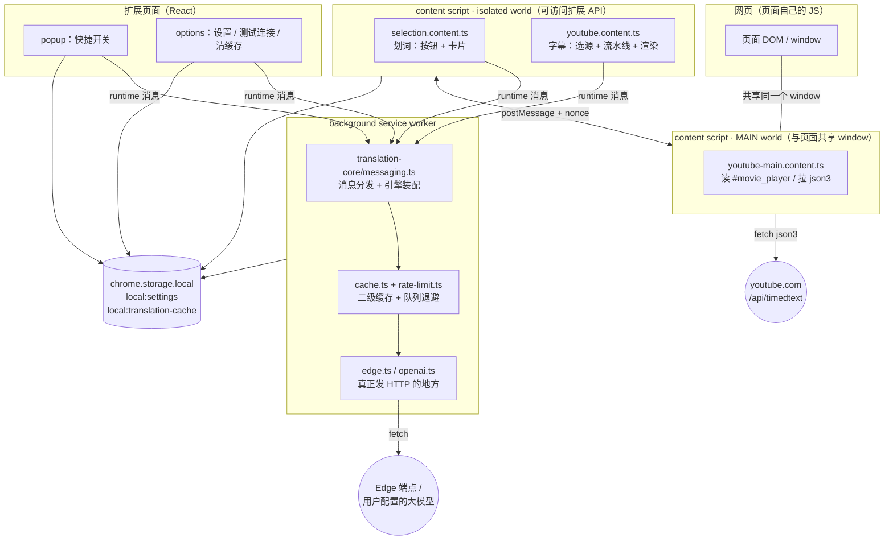
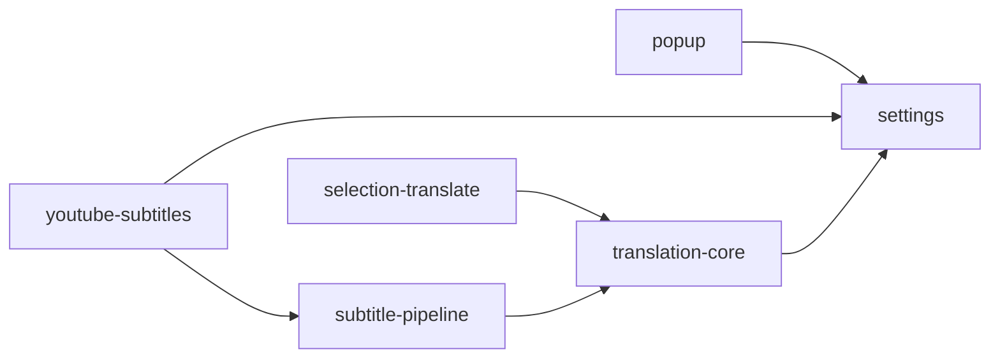
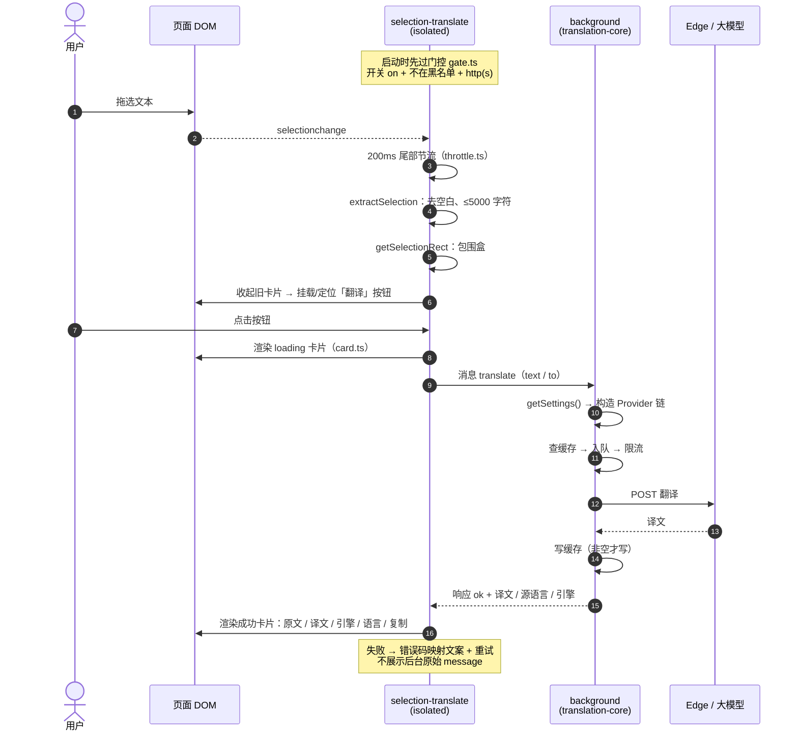
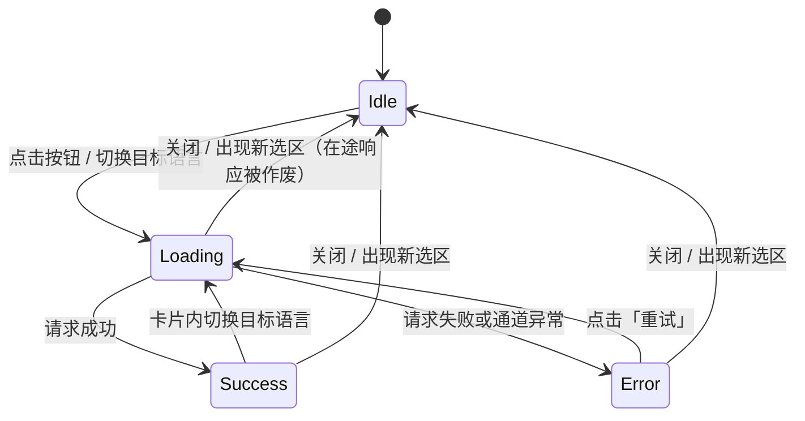
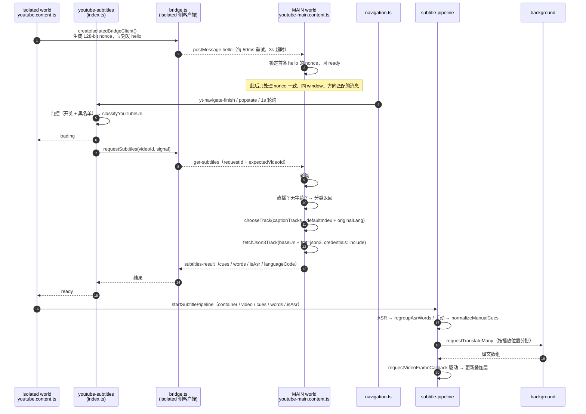
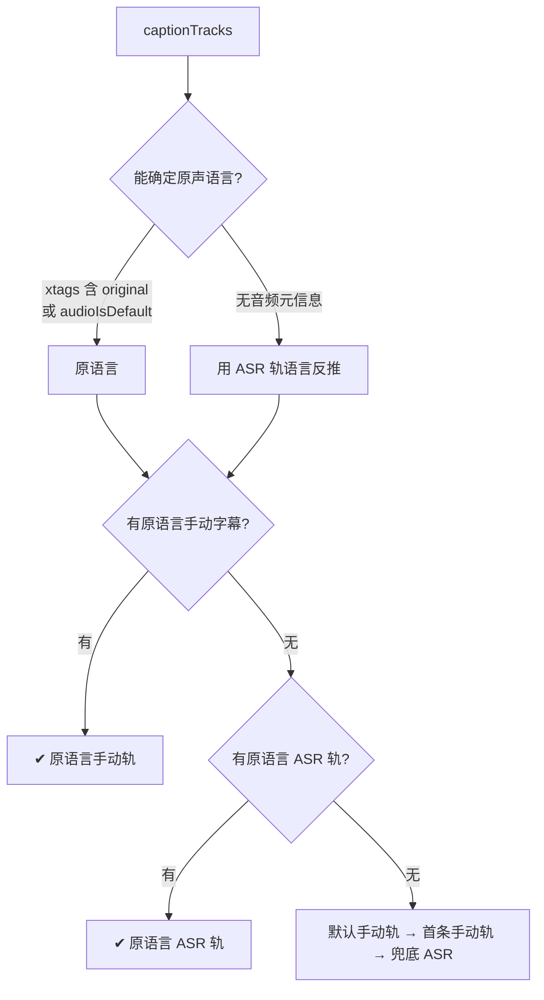
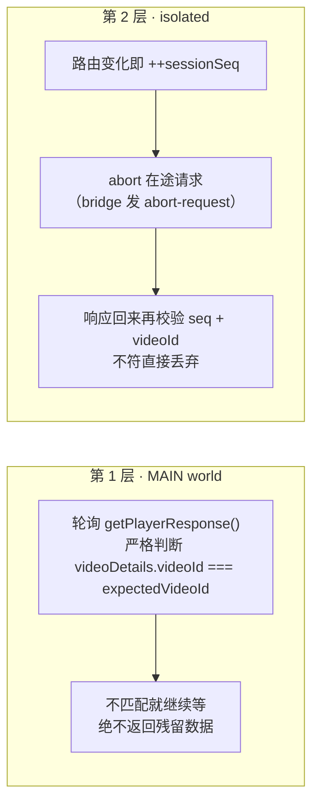
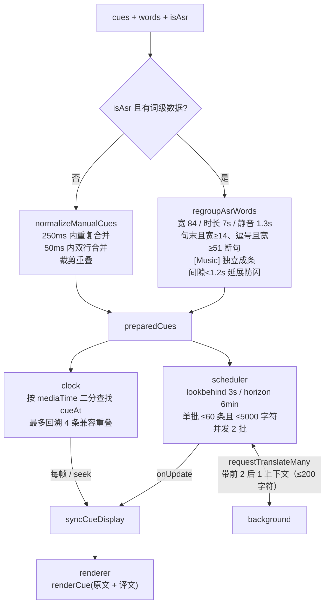
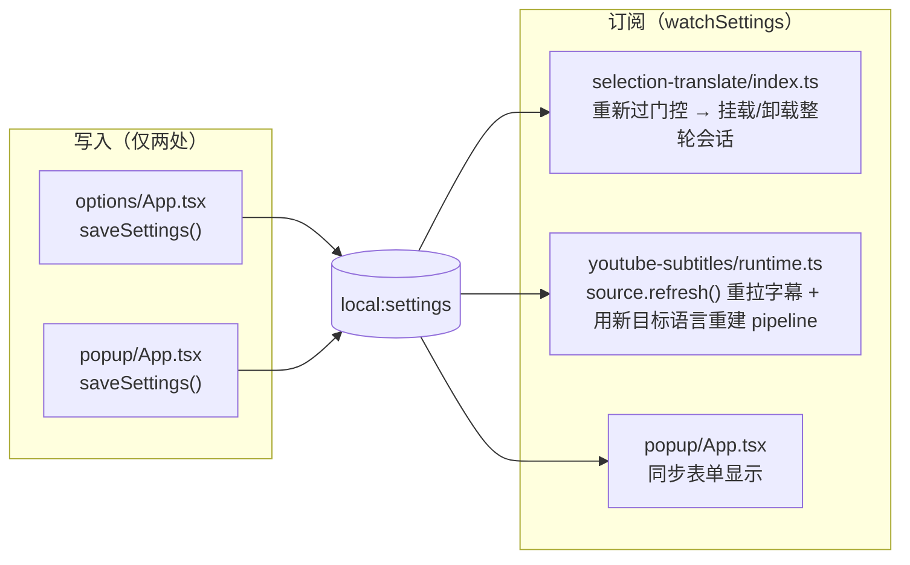
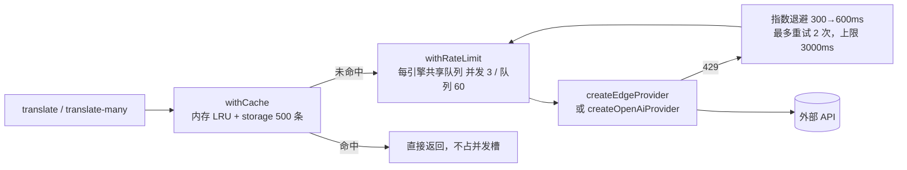

# translationApp

Chrome 扩展（Manifest V3）：**网页划词翻译** + **YouTube 双语字幕**。翻译引擎可切换（内置 Edge 免费端点 / 用户自备 key 的 OpenAI 兼容大模型），无自有后端，所有配置与缓存只存在本地。

- 划词：选中文本 → 浮层「翻译」按钮 → Shadow DOM 译文卡片（点击才请求，避免误触与无谓消耗）
- 字幕：读取 YouTube `captionTracks` → 轨道选择 → json3 字幕 → ASR 断句重组 → 按播放位置分批预翻译 → 帧级同步渲染
- 引擎：`Provider` 抽象 + 统一装饰链（缓存 → 并发队列 + 429 退避 → 具体引擎）
- 安全：所有网络请求只在 background 发出，API Key 不进入任何页面上下文

---

## 目录

- [1. 运行模型：四个上下文](#1-运行模型四个上下文)
- [2. 五分钟跑起来](#2-五分钟跑起来)
- [3. 文件地图](#3-文件地图)
- [4. 模块依赖与依赖规则](#4-模块依赖与依赖规则)
- [5. 主流程 A：划词翻译](#5-主流程-a划词翻译)
- [6. 主流程 B：YouTube 双语字幕](#6-主流程-byoutube-双语字幕)
- [7. 主流程 C：设置变更如何实时生效](#7-主流程-c设置变更如何实时生效)
- [8. 翻译引擎内部的装饰链](#8-翻译引擎内部的装饰链)
- [9. 存储与消息契约](#9-存储与消息契约)
- [10. 测试地图](#10-测试地图)
- [11. 关键设计取舍](#11-关键设计取舍)
- [12. 已知限制与实现细节](#12-已知限制与实现细节)
- [13. 文档索引与发布](#13-文档索引与发布)

---

## 1. 运行模型：四个上下文

扩展不是「一个程序」，而是四个互相隔离的执行环境，靠消息和共享存储协作。理解这个分界，就理解了全部架构。



| 上下文 | 入口文件 | 权限 | 能做什么 | 不能做什么 |
| --- | --- | --- | --- | --- |
| background | `entrypoints/background.ts` | 扩展全部权限 | 发翻译请求、读写 storage、处理消息 | 不能碰页面 DOM |
| content script（isolated） | `selection.content.ts`、`youtube.content.ts` | 扩展 API + 页面 DOM | 注入 UI、读配置、发消息 | 不能读页面 JS 变量 |
| content script（MAIN world） | `youtube-main.content.ts` | 仅页面环境 | 读 `#movie_player`、`window.ytInitialPlayerResponse` | **无任何扩展 API**，不读配置，碰不到 key |
| 扩展页面 | `popup/`、`options/` | 扩展 API | 改配置、发消息 | 无页面 DOM |

> 为什么要有 MAIN world：YouTube 把播放器数据挂在页面自己的 JS 对象上，isolated world 看不到。MAIN world 能读，但没有扩展 API，于是两边用 `postMessage` 建桥，读到的只是公开的字幕 URL 与文本。

---

## 2. 五分钟跑起来

环境：Node.js ≥ 24、pnpm ≥ 11、Chrome ≥ 88。

```bash
pnpm install     # 安装依赖，postinstall 自动执行 wxt prepare 生成 .wxt 类型
pnpm dev         # 开发模式：启动 Chrome 并加载扩展，改代码自动热更新
pnpm test        # vitest 单元/集成测试（jsdom + fakeBrowser，无真实网络）
pnpm lint        # eslint
pnpm compile     # tsc --noEmit 类型检查
pnpm build       # 构建到 .output/chrome-mv3
pnpm zip         # 构建并打包 .output/translation-app-<版本>-chrome.zip
```

手动加载产物：`chrome://extensions` → 开启「开发者模式」→「加载已解压的扩展程序」→ 选 `.output/chrome-mv3`。

首次使用：打开设置页选目标语言即可直接翻译（默认走 Edge 免费端点）。要换大模型则在设置页填 `Base URL` / `API Key` / 模型，点「测试连接」确认后再保存。

---

## 3. 文件地图

### 3.1 顶层

```
entrypoints/        各运行环境的入口（薄壳：接线 + 生命周期）
modules/            业务模块（逻辑都在这里，每个模块自带 README 与单测）
docs/               规划、架构、隐私、上架材料
tests/              跨模块测试（安全回归、manifest 契约、冒烟）
wxt.config.ts       manifest 与构建配置
vitest.config.ts    jsdom 环境 + WxtVitest 插件（注入 fakeBrowser）
```

`wxt.config.ts` 里有一处必要的小动作：

```ts
modulesDir: 'wxt-modules',   // 业务目录 modules/ 与 WXT 的「本地模块」目录约定撞名，
                             // 指向不存在的空目录，避免 WXT 把业务代码当插件模块加载
```

### 3.2 `entrypoints/` — 只做接线，不写业务

| 文件 | 职责 |
| --- | --- |
| `background.ts` | 启动 service worker：`registerTranslateHandler()` 注册消息入口，`purgeStaleCache()` 清理过期缓存版本 |
| `selection.content.ts` | 在 `*://*/*` 启动划词；监听 `wxt:locationchange`，SPA 换页后重新做门控判定 |
| `youtube.content.ts` | isolated world，`document_start` 启动字幕全链路 `startYouTubeSubtitles()` |
| `youtube-main.content.ts` | MAIN world，`document_start` 启动 `startMainWorldBridge()`（必须先于页面脚本执行才能抢到首次握手） |
| `popup/index.html` + `main.tsx` + `App.tsx` | 工具栏弹窗：引擎/语言下拉、两个功能开关、当前站点开关、设置入口 |
| `options/index.html` + `main.tsx` + `App.tsx` | 设置页：语言、引擎、key/base/model、功能开关、黑名单、保存 |
| `options/TestConnection.tsx` | 「测试连接」：**先落盘**再让 background 发探针请求（否则后台读到的是旧配置） |
| `options/ClearCache.tsx` | 「清除翻译缓存」：经消息交给 background 执行（缓存体在 background 侧） |

### 3.3 `modules/` — 六个业务模块

```
modules/
├── settings/              配置读写 + 黑名单判定（纯数据，无业务依赖）
├── translation-core/      翻译引擎、消息通道、缓存、限流退避（background 专用）
├── selection-translate/   划词：选区 → 按钮 → 卡片
├── youtube-subtitles/     YouTube 字幕源：选轨、桥、路由跟随、防串台
├── subtitle-pipeline/     平台无关字幕流水线：重组、调度、时钟、渲染
└── popup/                 弹窗视图模型与纯函数式配置变换
```

每个模块里的文件按「职责层」切分，命名规律固定：

| 后缀/名字 | 含义 | 例子 |
| --- | --- | --- |
| `*.ts`（纯函数） | 无副作用、好测试的核心算法 | `regroup.ts`、`cache-key.ts`、`track.ts` |
| `*.ts`（controller/scheduler/clock） | 有状态、管生命周期的编排 | `controller.ts`、`scheduler.ts`、`clock.ts` |
| `*-style.ts` / `*.css`-in-ts | 样式常量（Shadow DOM 内联） | `card-style.ts` |
| `index.ts` | 唯一对外出口，只 re-export | 各模块 |
| `README.md` | 该模块的公开 API、契约、测试与限制 | 各模块 |
| `*.test.ts` | 与实现同目录的单测 | — |

---

## 4. 模块依赖与依赖规则



规则（由 `docs/ARCHITECTURE.md` 定义，改动需同步该文档）：

1. `settings` 是叶子：纯数据，不依赖任何业务模块。
2. `translation-core` 是**唯一**读引擎配置（含 key）的模块；其他模块只会「发消息」，从不构造引擎。
3. `subtitle-pipeline` 平台无关：不含任何 YouTube 选择器。接入 B 站只需新写一个源模块，把容器、`<video>`、字幕数组喂给它。
4. 禁止反向依赖、禁止业务模块互相依赖。

---

## 5. 主流程 A：划词翻译

涉及文件：`entrypoints/selection.content.ts` → `modules/selection-translate/{index,gate,selection,button,controller,card,throttle}.ts` → `translation-core/messaging.ts` → `edge.ts`。



### 关键行为

| 行为 | 实现位置 | 说明 |
| --- | --- | --- |
| 门控 | `gate.ts` | 功能开关、黑名单（含子域）、协议白名单、读配置失败一律不激活 |
| 节流 | `throttle.ts` | `selectionchange` 与 `scroll` 共用 200ms 尾部节流，拖拽中只处理最后一帧 |
| 选区上限 | `selection.ts` | 默认 5000 字符，超出视为误选整页 |
| 定位 | `button.ts` / `card.ts` | 默认贴选区下方，空间不足翻到上方，左右收拢到视口内 |
| 旧响应作废 | `controller.ts` | 每次请求递增 `requestId`，响应到达时序号不符即丢弃 → 快速改选区不会被「先发后到」覆盖 |
| 重复请求抑制 | `controller.ts` | 同一文本、目标语言未变且卡片仍可见时不再发请求 |
| 样式隔离 | `button.ts` / `card-style.ts` | 全部寄生在 open shadow root，`all: initial`，`z-index: 2147483647` |
| 隐私 | 全链路 | 卡片只展示 `formatUserError(code)` 的结果，后台返回的 `message` 仅留作诊断 |

### 卡片状态机



---

## 6. 主流程 B：YouTube 双语字幕

这是全项目最复杂的一条链路，横跨两个 world、三个模块。分两段看：**拿到字幕** 与 **显示字幕**。

### 6.1 全景时序



### 6.2 阶段表：每一步落在哪个文件

| 阶段 | 文件 | 做什么 |
| --- | --- | --- |
| ① 路由跟随 | `youtube-subtitles/navigation.ts` | 订阅 `yt-navigate-finish` / `yt-page-data-updated` / `popstate`，加 1s URL 轮询兜底；解析 `/watch?v=`、`/embed/`、`/shorts/` |
| ② 门控 | `youtube-subtitles/index.ts` | `features.youtubeSubtitles` + `blockedHosts` + `http(s)`；不满足直接 `idle`，不动页面 |
| ③ 握手 | `youtube-subtitles/bridge.ts` | `crypto.getRandomValues` 生成 nonce；hello 重试间隔 50ms，握手超时 3s，单请求超时 20s（需等播放器 POT 请求与备用客户端兜底） |
| ④ 读播放器数据 | `youtube-subtitles/main-world.ts` | 轮询 `#movie_player.getPlayerResponse()`（间隔 150ms，超时 8s），首屏回退 `window.ytInitialPlayerResponse`，**两者都必须 videoId 匹配** |
| ⑤ 选轨 | `youtube-subtitles/track.ts` | 见下方优先级 |
| ⑥ 拉字幕 | `youtube-subtitles/json3.ts` | 补 `fmt=json3`、带 cookie 请求、解析事件级 `cues` 与 ASR `words` |
| ⑦ 重组 | `subtitle-pipeline/regroup.ts` | ASR 词序列 → 可读 cue；手动字幕去重 / 合并双行 / 裁剪重叠 |
| ⑧ 预翻译 | `subtitle-pipeline/scheduler.ts` | 位置感知分批，最多 2 批并发 |
| ⑨ 时钟 | `subtitle-pipeline/clock.ts` | `requestVideoFrameCallback` 取 `mediaTime`（不支持则 rAF），处理 seek/pause/play/ratechange |
| ⑩ 渲染 | `subtitle-pipeline/renderer.ts` | 播放器容器内 Shadow DOM 叠加，原文白 + 译文暖黄，`cqh` 自适应字号 |

### 6.3 选轨优先级（`track.ts`）



语言码归一化：中文区分简繁（`zh-TW`/`zh-HK`/`zh-Hant` → `zh-hant`，其余 `zh*` → `zh-hans`），其他语言取小写主标签（`en-US` → `en`）。

### 6.4 双 world 桥协议与防串台

消息信封：

```ts
interface BridgeEnvelope<M> {
  source: 'translation-app:yt-bridge';  // 固定标识
  dir: 'to-main' | 'to-isolated';       // 方向
  nonce: string;                        // 本页会话随机值，128-bit hex
  msg: M;                               // { type: 'hello' | 'get-subtitles' | 'abort-request'
                                        //        | 'ready' | 'subtitles-result' }
}
```

收消息时三重校验：**同 window** + **source/dir 匹配** + **nonce 一致**。页面上的第三方脚本既猜不到 nonce，也无法伪造方向。

防串台（快速切视频时不显示上一条视频的字幕）做了两层：



### 6.5 字幕流水线内部



调度器的三个「锚点」决定了请求何时发：

| 参数 | 值 | 作用 |
| --- | --- | --- |
| lookbehind | 3s | 当前时间前 3s 内未结束的 cue 仍优先翻译（刚错过一点也要补） |
| horizon | 6min | 更远的字幕先不翻，避免拖动进度条时白烧额度 |
| `seek` | 重置失败冷却 | 用户主动跳转后，之前失败的区段允许重试 |
| 失败冷却 | 5s / 最多 3 次 | 批次失败后冷却到期自动重试，用尽后仅在 seek 时重拉（不会一失败就整段只剩原文） |

### 6.6 渲染与降级

| 场景 | 行为 |
| --- | --- |
| 正常 | 在播放器容器内插 Shadow DOM 叠加层；`container-type: size` + `cqh` 让字号随播放器缩放 |
| 原字幕 | 给容器加 `data-translation-app-hide-native` 属性，配合注入的样式表隐藏 `.ytp-caption-window-container` |
| `<video>` 自身全屏 | 叠加层会被浏览器盖住 → 自动降级写入原生 `TextTrack`，退出全屏恢复 |
| 直播 / 首映 | 不挂流水线，展示 4.5s 轻提示条「暂不支持双语字幕」 |
| Shorts | 同上（提示 Shorts 不支持） |
| 无字幕 | 不挂流水线，展示 4.5s 轻提示条「该视频没有可用的字幕轨道」 |
| 拉取失败 / 桥超时 | 不隐藏原字幕，展示提示条「字幕获取失败」，详情只进 console |
| 译文批量失败 | 叠加层内提示条显示错误文案（自动隐藏），调度器冷却后自动重试 |
| 关闭开关 / 加入黑名单 | `watchSettings` 触发 → 销毁 pipeline → 叠加层移除、原字幕恢复 |

---

## 7. 主流程 C：设置变更如何实时生效

三个写入方（options 页、popup、无）都只写 `local:settings`；三个读取方各自订阅变更。没有任何地方需要「重启扩展」或「刷新页面」。



注意 `selection-translate` 的 evaluate 用了 `seq` 序号：连点开关时，晚到的旧判定结果会被丢弃，不会出现「关了又自己挂上」。

popup 的纯函数变换集中在 `modules/popup/state.ts`，UI 只负责渲染：

| 函数 | 作用 |
| --- | --- |
| `derivePopupViewModel(settings, tabUrl)` | 生成视图模型：开关值、引擎名与就绪态、语言名、当前站点启用态与命中的黑名单规则 |
| `changeEngine` / `changeTargetLanguage` / `toggleFeatureSwitch` | 返回新 `Settings`（不落盘，由 UI 调 `saveSettings`） |
| `toggleSiteEnabled(settings, host, enabled)` | 禁用 = 写入 `blockedHosts`；启用 = 删除精确项与覆盖该子域的父域项 |

popup 能拿到当前 URL 靠的是 `activeTab`：用户点击扩展图标那一刻授予的临时权限，不需要常驻 `tabs` 权限。

---

## 8. 翻译引擎内部的装饰链

`background` 收到消息后，每次都按当前 `settings` 现搭一条链（`messaging.ts: createConfiguredProvider`）：



顺序很关键：**缓存在外层**，命中时不排队、不退避、不发请求。

### 缓存键与失效

```
key = 引擎 \0 目标语言 \0 源语言(=auto 或缺省) \0 归一化文本 \0 v2
```

- 文本归一化：去首尾空白、合并连续空白（`" a  b "` 与 `"a b"` 同键）
- `v2` 是 prompt/逻辑版本号：改提示词后递增即让所有旧条目自然失效（`purgeStaleCache()` 在 background 启动时回收空间）
- 不缓存：空文本（直接透传）、空译文、任何抛错的结果 → 失败重试一定真发
- **不包含** `apiKey` / `baseUrl`：换了 key 或模型，旧译文仍会命中 → 设置页建议清一次缓存

### 错误码与文案

| 情形 | 码 | 用户看到 |
| --- | --- | --- |
| fetch 失败、超时（30s 默认） | `network` | 网络连接失败，请检查网络后重试 |
| HTTP 429 | `rate-limit` | 请求过于频繁，请稍后再试 |
| HTTP 401/403 或未填 key | `authentication` | 引擎鉴权失败，请检查密钥设置 |
| HTTP 400（Edge 不支持该语言对） | `unsupported-language` | 该语言组合暂不支持 |
| 其他非 2xx、非 JSON、缺译文、批量条数不符 | `unknown` | 翻译失败，请稍后重试 |

`error-messages.ts` 还提供 `hasInternalErrorLeak()`，测试用它断言文案里没有堆栈、HTTP 状态行、JSON 结构或 `sk-` 密钥。

### 两个引擎的差异

| | Edge 端点 | OpenAI 兼容 |
| --- | --- | --- |
| 端点 | `POST https://edge.microsoft.com/translate/translatetext` | `{baseUrl}/chat/completions` |
| 鉴权 | 无 | `Authorization: Bearer {apiKey}` |
| 语言传参 | 微软语言码（`zh-CN → zh-Hans`） | **自然语言名**：`简体中文（zh-CN / Simplified Chinese）` |
| 批量 | 原生支持（body 是 `string[]`） | 要求模型返回等长 JSON 数组，容忍 ` ```json ` 包裹，条数不符即报错 |
| 超时 | 默认 | 30s，`AbortController` 中断后归类为 `network` |

大模型提示词有三处「反直觉但必需」的细节，都在 `openai.ts` 里注明了原因：

1. **指令同时写进 system 和 user**：部分兼容端点会忽略 system role，只看到原文时会把半句话当聊天内容，回一段安慰。
2. **明确要求「片段不完整也照译，不要回答/追问/补全」**：划词和 ASR 经常截到半句。
3. **`auto` 不能当语言名传**：写成「源语言自动识别。」，否则模型会误判输出语言。

---

## 9. 存储与消息契约

### 9.1 storage

| 键 | 形状 | 读写方 |
| --- | --- | --- |
| `local:settings` | `Settings`（整对象） | 写：options / popup；读：所有上下文 |
| `local:translation-cache` | `Record<缓存键, { text, from, engine }>` | 仅 background |

`Settings` 缺失字段用 `DEFAULT_SETTINGS` 逐层深合并补齐（`settings/store.ts: withDefaults`），老版本存档不会因为新增字段而崩。新增字段时必须同步补默认值。

### 9.2 扩展消息（content/options/popup ↔ background）

信封 `{ type, data }`，响应统一为「不抛异常、以码透传」：

```ts
type MessageResponse =
  | { ok: true; result: TranslationResult }
  | { ok: false; code: TranslationErrorCode; message: string };
```

| type | data | 调用方 |
| --- | --- | --- |
| `translate` | `{ text, to?, from? }` | 划词卡片 |
| `translate-many` | `{ texts, to?, from? }` | 字幕批量 |
| `test-connection` | `{ engine? }` | 设置页 |
| `clear-cache` | `{}` | 设置页 |

`to` 缺省时由 background 取 `settings.targetLanguage`；`from` 缺省时引擎自动识别。

---

## 10. 测试地图

`pnpm test` 全部离线运行：`WxtVitest` 注入 `fakeBrowser`，各用例 `vi.stubGlobal('fetch', ...)` 打桩，不依赖 key、网络和真实 YouTube。

| 目录 | 覆盖重点 |
| --- | --- |
| `modules/settings/*.test.ts` | 默认值、读写往返、残缺存档补齐、黑名单精确/子域/相似前缀/大小写 |
| `modules/translation-core/*.test.ts` | 两个引擎的成功/429/401/400/超时/非 JSON/SSE、批量顺序与条数校验、语言码映射、消息往返、缓存命中与键隔离、限流退避、错误文案脱敏 |
| `modules/selection-translate/*.test.ts` | 选区提取与矩形（含 iframe 定位失败）、门控、按钮定位与上翻、节流、卡片三态、旧响应作废、控制器生命周期 |
| `modules/youtube-subtitles/*.test.ts` | 选轨优先级、json3 解析（ASR 词级展开）、桥的伪造消息拦截与超时、首屏回退与残留 videoId、路由跟随去重、切视频防串、端到端渲染 |
| `modules/subtitle-pipeline/*.test.ts` | 重组规则边界（宽度/时长/静音/标点/防闪）、批计划窗口与上限、上下文裁剪、seek 重算、`cueAt` 重叠回溯、rVFC 与 rAF 降级、全屏 TextTrack 降级 |
| `modules/popup/state.test.ts` | 视图模型与纯函数式配置变换 |
| `entrypoints/**/*.test.tsx` | 弹窗/设置页渲染、跳转、保存后重挂载仍保留、测试连接与清缓存交互 |
| `tests/manifest.test.ts` | manifest 权限严格等于 `[storage, activeTab]`，无 `host_permissions` |
| `tests/security-regression.test.ts` | **构建产物**扫描：content script 内不得出现 `chat/completions`、`Bearer`、`sk-`、`apiKey`；运行时消息与 DOM 不得含密钥；跨模块全链路（缓存 → 清缓存 → 429 退避 → 拉黑即时停用 → YouTube 双语） |
| `tests/smoke.test.ts` | 工具链接线（fakeBrowser 已注入） |

> `tests/` 里两个契约测试会读取 `.output/chrome-mv3/**` 的产物做静态扫描；未构建时自动跳过，因此**发版前应跑一次 `pnpm build && pnpm test`** 才能覆盖产物级检查。

---

## 11. 关键设计取舍

| 决定 | 原因 |
| --- | --- |
| 所有翻译请求只在 background 发出 | MV3 里 key 无法对页面隐藏，唯一的防线是「key 根本不出现在页面上下文」。content script 只发消息 |
| 划词「选中只出按钮，点击才翻译」 | 阅读时误选极常见；自动翻译会持续烧额度 |
| MAIN world 桥用随机 nonce 而非固定标识 | `postMessage` 任何人都能发，固定标识可被页面脚本伪造、诱导扩展去拉取任意 URL |
| 字幕预翻译是「按播放位置的窗口」而非全量 | 全量翻译一个长视频会瞬间打爆限流；窗口 + seek 重算兼顾体验与成本 |
| ASR 字幕要按词重组 | YouTube ASR 是一串两三词的碎片，直接翻译会得到断句错误的译文 |
| 提示词用自然语言语言名 | `zh-CN` 对大模型是歧义输入，会输出繁体或回英文解释 |
| 缓存键带 prompt 版本号 | 否则改了提示词仍然命中旧结果，表现为「改了代码毫无变化」，极难排查 |
| 错误只透传码，不透传 message | 后台 message 可能含堆栈、HTTP 状态行、上游 JSON 甚至 key 片段 |
| `modulesDir: 'wxt-modules'` | `modules/` 与 WXT 本地模块目录约定同名，会被误当作 WXT 模块加载 |

---

## 12. 已知限制与实现细节

- **缓存的内存层**：`withCache` 的 LRU 随每条消息新建 Provider 链而重建，因此**跨请求真正生效的是 `storage.local` 层**（默认 500 条，按写入顺序淘汰最旧）。内存层只在单次调用内命中。
- **改 key/模型后需手动清缓存**：缓存键不含 `apiKey`/`baseUrl`。
- **模型不保证只输出译文**：提示词只能降低概率。出现解释或对话式回应时，换更强模型或改用 Edge 引擎。
- **Edge 端点无 SLA**：可能随时限流或下线；引擎抽象让替换只改一个模块。
- **依赖 YouTube 非公开约定**：`captionTracks`、`yt-navigate-finish`、`#movie_player` 结构变化会破坏字幕；WEB 客户端签名 URL 缺 POT 令牌时 `timedtext` 返回 200 + 空 body，因此优先复用播放器自己带 `pot` 的字幕请求 URL，再依次回退 `fmt=json3` → XML → 备用客户端；全部失败则保持原字幕并展示提示条。
- **字幕不支持的场景**：直播/首映、Shorts、无字幕视频只显示提示条。
- **语言表覆盖有限**：`language.ts` 未收录的码原样传给模型。
- **未实现流式输出**：`stream: false`；上游强制 SSE 会以 `unknown` 报错。
- **不做的**：整页双语翻译、YouTube 以外的平台、账号体系、云同步、词典/生词本（见 `docs/PLAN.md` 的范围边界）。

---

## 13. 文档索引与发布

| 文档 | 内容 |
| --- | --- |
| [`docs/PLAN.md`](docs/PLAN.md) | 产品与技术决策、为什么不用现成方案、一期范围外的事 |
| [`docs/ARCHITECTURE.md`](docs/ARCHITECTURE.md) | 模块清单、依赖方向、通信约定、MVP 与模块对照 |
| [`docs/TODO.md`](docs/TODO.md) | 任务队列、每项验收标准与前置依赖 |
| [`docs/PRIVACY.md`](docs/PRIVACY.md) | 隐私声明（可作为商店要求的公开政策） |
| [`docs/STORE_LISTING.md`](docs/STORE_LISTING.md) | 商店文案、权限理由、截图清单 |
| `modules/*/README.md` | 各模块的公开 API、契约、测试覆盖与限制 |

各模块 README 是**内部契约的权威来源**（签名、字段、异常、行为约定）；本 README 只解释整体如何运作。改代码时同步对应模块 README；改模块边界时同步 `docs/ARCHITECTURE.md`。

发布：

```bash
# 1. 递增 package.json 的 version（语义化）
pnpm build && pnpm test    # 产物级安全检查需要先 build
pnpm zip                   # .output/translation-app-<version>-chrome.zip
# 2. Chrome Developer Dashboard → 对应 item → Package → 上传 zip → Submit for review
```

权限必须保持 `[storage, activeTab]` 且无 `host_permissions`；`tests/manifest.test.ts` 会守门。上架前的完整自检清单、被拒常见原因与更新流程见 [`docs/STORE_LISTING.md`](docs/STORE_LISTING.md)。
