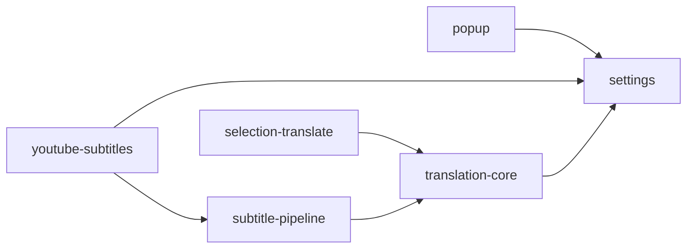

# translationApp — 架构

模块按业务划分。内部契约（签名、字段、异常）见各模块 `README.md`，本文只定模块边界与依赖方向。

## 模块清单

| 模块 | 职责 | 运行位置 |
| --- | --- | --- |
| `translation-core` | 统一 `translate()` 接口与引擎实现（Edge 端点、OpenAI 兼容）、翻译结果二级缓存、限流退避 | background（service worker），经消息对外暴露 |
| `settings` | 用户配置存取：目标语言、引擎与 key/base URL、功能开关、站点黑名单判定；设置页 UI | options 页 + 各端读取 |
| `selection-translate` | 划词检测、浮层按钮、译文卡片 | content script |
| `youtube-subtitles` | YouTube 字幕获取：captionTracks 选轨、MAIN world 桥、SPA 路由跟随、视频切换防串 | content script（双 world） |
| `subtitle-pipeline` | 平台无关字幕流水线：ASR 字幕重组为 cue、位置感知预翻译调度、时间轴同步、双语渲染 | content script |
| `popup` | 工具栏弹窗：划词/字幕快捷开关、当前引擎状态、设置入口 | popup |

## 依赖方向

规则：

- `settings` 是纯数据模块，不依赖任何业务模块
- `translation-core` 读 settings 构造引擎实例（含连通性测试），是唯一的配置消费方；其余模块只发翻译/测试消息，不碰引擎配置
- `subtitle-pipeline` 平台无关，二期 B 站等新平台只新增 source 模块对接它
- 禁止反向依赖与相互依赖

## 运行环境与通信约定

- 所有翻译 API 请求只从 background 发出，大模型 key 不进入 content script
- content ↔ background：扩展消息（`@webext-core/messaging`，WXT 生态配套）
- 页面 ↔ content：`postMessage` + 随机 nonce 校验，仅 `youtube-subtitles` 的 MAIN world 桥使用
- 翻译入口统一为一个消息通道，划词与字幕共用，缓存与退避在通道内生效

## MVP → 模块承接对照

| PLAN 一期内容 | 承接模块 |
| --- | --- |
| 引擎抽象 + Edge 引擎 | `translation-core` |
| OpenAI 兼容大模型引擎 | `translation-core` |
| 翻译结果缓存、限流退避 | `translation-core` |
| 设置页（语言/引擎/key/连通性测试） | `settings` |
| 站点黑名单、功能开关存储 | `settings` |
| 划词翻译 | `selection-translate` |
| YouTube 字幕获取 | `youtube-subtitles` |
| 字幕重组/预翻译调度/同步渲染 | `subtitle-pipeline` |
| 工具栏弹窗开关 | `popup` |
